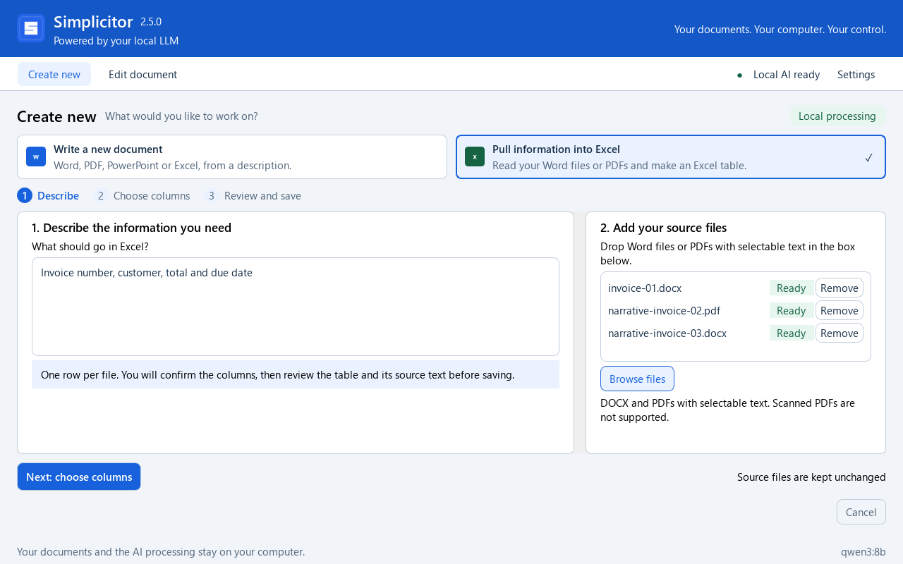

# Simplicitor

[](LICENSE)

Windows desktop document work with local models.

English is the target language. Other languages may work but are not tested or claimed.

## Project direction

[PRD.md](PRD.md) is the source for release scope, prerequisites, later milestones, and acceptance gates. [Project status](docs/PROJECT_STATUS.md) shows what exists and the decisions still open.

The review set is the [document architecture](docs/superpowers/specs/2026-10-08-document-architecture-design.md), [UI design](docs/superpowers/specs/2026-10-08-document-workspace-ui-design.md), and [2.2.0 implementation plan](docs/superpowers/plans/2026-10-12-release-2.2.0.md). Build procedures are in [packaging](docs/code-signing.md). Historical phase plans describe earlier versions.

## Screenshot



## Install and run

### Download the binary

Published downloads are on the [Releases](https://github.com/alexnosx/Simplicitor/releases) page. For 2.2.0, the package files are (see the [release notes](docs/releases/v2.2.0-notes.md)):

- `Simplicitor-2.2.0.msi`: installs for the current Windows user.
- `Simplicitor-portable.zip`: unpack and run `Simplicitor.exe` without installing.
- `SHA256SUMS.json`: download checksums.

For the MSI, uninstall an existing 2.0.0 setup.exe installation from Settings > Apps first. Settings and documents are preserved. The MSI is unsigned and Windows may show an unknown-publisher or security warning. Packaging does not remove that warning.

### Build from source

On your Windows development machine, you need Python 3.11+, Git and the .NET 8 SDK. From PowerShell:

```powershell
git clone https://github.com/alexnosx/Simplicitor.git
cd Simplicitor
python -m venv .venv
.\.venv\Scripts\python.exe -m pip install -r requirements.txt -r requirements-build.txt
dotnet tool restore
.\.venv\Scripts\python.exe build.py
```

Outputs in `dist`: `Simplicitor-2.2.0.msi`, `Simplicitor-portable.zip` and `SHA256SUMS.json`. The build creates the installer but does not run it. See [packaging](docs/code-signing.md) for details.

### Run from source without building

From PowerShell in the checkout, create the environment once if needed:

```powershell
py -3 -m venv .venv
.\.venv\Scripts\python.exe -m pip install -r requirements.txt
```

Start Ollama, then launch the application:

```powershell
.\.venv\Scripts\python.exe .\simplicitor\main.py
```

Open Settings and select an installed local model.

Try one synthetic extraction:

1. Keep **Create new** selected and choose **Pull information from documents into Excel**. In Source files, click **browse** and choose `tests\extraction\fixtures\invoice-01.docx`. This option always produces Excel.
2. Enter: `Extract the invoice number, customer name, gross total, and due date.`
3. Click **Next: choose columns**. Edit the names/descriptions/types if needed. Keep identifiers as text. If a date column has ambiguous numeric dates, choose the day/month order in its details.
4. Click **Extract to Excel** to confirm the columns and start extraction.
5. Select grid values to inspect their saved quotes, anchors, and issues. This fixture should retain invoice ID `00123` as text, gross total `12500.00` as a number, and due date `2026-04-14` as a date.
6. If output is flagged or incomplete, review it and check the acknowledgement. Click **Save to Excel** to choose a new `.xlsx` file. Windows asks before replacing an existing output; source files cannot be replaced.

To create from a prompt, choose **Write a new document**, describe it, select Word, PDF, Excel or PowerPoint and click **Create file**. PowerPoint offers **Use a template** with the two built-in designs. Each option keeps its own inputs when you switch; writing does not use attached source files. Leaving Pull clears its columns and review, ready for a new extraction.

Files show Reading, Ready or Partly read. Check named reading problems before using the table: text boxes, tracked changes (including moved text), form fields and other supported warnings can identify information that was not read. Progress appears on each file and the main button. Highlighted values or reading problems require acknowledgement before saving.

**Edit document** explains that Edit for Word arrives in 2.3.0. It comes before table-row extraction and needs its own approved design; editing is not available in 2.2.0.

## Requirements

A GPU with 8 GB VRAM is recommended, not required or checked.

See [release prerequisites](PRD.md#workflow-scope) and the [model evaluation requirements](PRD.md#limits-and-evaluation-gates). For the existing application, start Ollama locally and pull a model with `ollama pull <model>`.

## Generate from a template (PowerPoint)

Choose a built-in PowerPoint design and describe the presentation. The local model proposes content; Simplicitor validates it and fills the template's layouts.

**How it works:**

1. In **Write a new document**, select PowerPoint and click **Use a template**.
2. Pick **business_pitch** or **technical_overview** and confirm the structure. The screen shows **Template: <name>** and **Clear**.
3. Type your prompt in the main Create field and click **Create file**. The deck is rendered into the template's design.

**What ships:**

- **`business_pitch`**: a 16x9 template with title, agenda, content and closing slide types.
- **`technical_overview`**: title, architecture and bullet layouts for engineering documentation.

Both seed on first launch into `Documents\Simplicitor\Templates`; the location is configurable in Settings. The app picker offers the built-in designs only.

**What the LLM sees:**

Your description and the template schema: field names, slide types, character/item limits and an example assembled from the manifest. The model produces JSON keyed to those fields; Python validates and renders it. The existing repair attempt and failure messages remain.

### Developer template tools

The CLI (`python simplicitor/cli.py`) retains template import and generation as developer tools. Developer-created library entries are not shown in the app's built-in picker.

## How it was built

Simplicitor was built PRD-first: a v1.0 PRD was written before any code, iterated to v1.2 against scope creep and architectural stress tests, then broken into six implementation phases. Claude Opus 4.6 was the strategic thinking partner for architecture and contract design; Claude Code handled all implementation across approximately 1.4 million tokens of generation. The human role was PM, architect, code reviewer, and tester — not coder. Not a single line of code was written by hand. See [BUILD_STORY.md](BUILD_STORY.md) for the full account.

## Architecture at a glance

Use the [repository map](REPO_MAP.md) for existing module responsibilities, the [architecture design](docs/superpowers/specs/2026-10-08-document-architecture-design.md) for document components and packaging, and [project status](docs/PROJECT_STATUS.md) for implementation state and known defects.

## License

Simplicitor 2.0.0 onward is licensed under the [MIT License](LICENSE), copyright (c) 2026 Alexandru Pop. Personal and commercial use, modification, and distribution are permitted under its terms. Releases up to and including v1.2.1 remain under [PolyForm Noncommercial 1.0.0](https://github.com/alexnosx/Simplicitor/blob/v1.2.1/LICENSE). See [LICENSE_NOTICE.md](LICENSE_NOTICE.md) for a plain-English summary and the third-party license distinction.

## Contributing

Issues are welcome but not guaranteed to be addressed — this is a personal demonstration project with limited maintenance bandwidth. Pull requests are not currently accepted. Forks are encouraged under the license terms.

## Author

Built by [Alexandru Pop](https://www.linkedin.com/in/alexandru-pop-b29b73198/)
